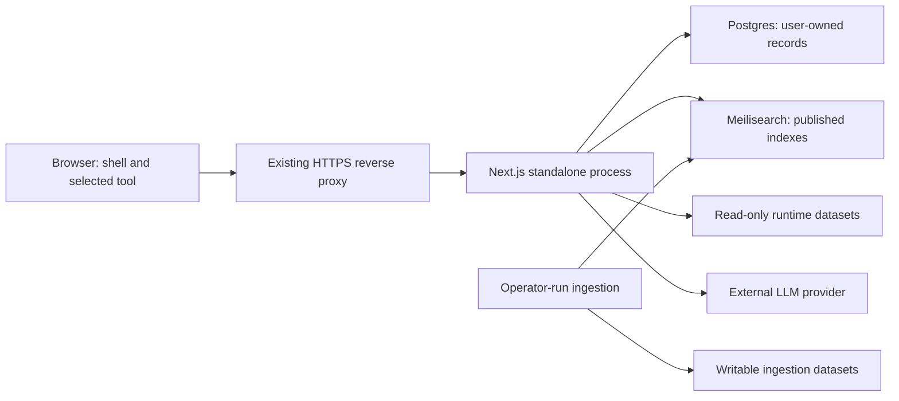

# Design Document: Production Efficiency

## Overview

Optimize Reodite for the selected deployment: one Docker Compose host running the Next.js application, Postgres, and Meilisearch. Prioritize resource use under concurrent requests, abandoned chat streams, cold dataset loads, and indexing. Reduce unnecessary build tracing and browser code loading. Refactor only where the change supports a measured cost or a reproducible resource-lifecycle defect.

Keep the current application architecture, routes, authentication, data contracts, and interface behavior. Preserve complete document retrieval, source verification, search coverage, and atomic snapshot publication. Exclude visual redesign, framework replacement, new infrastructure services, changes to the data submodule, and file splitting based only on file size.

This document proposes the design for review. Application code remains unchanged. Host capacity and expected traffic are unspecified, so absolute CPU/RAM allocations and latency objectives require a baseline on the deployment host. The acceptance checks below distinguish deterministic resource bounds from performance measurements; they do not claim an improvement before implementation.

## Architecture

### Deployment and ownership

Retain the multi-stage Node 24 Alpine image, non-root standalone runner, and externally mounted datasets. Run one application process so in-memory dataset caches and the database pool have one owner. Keep ingestion outside request handling and application startup. Build the image before deployment rather than compiling alongside the live database and search engine.



The reverse proxy is a deployment prerequisite from `SECURITY.md`, not an additional service introduced by this refactor. Application limits complement its request and connection controls. App, database, and search limits must share the host budget, including filesystem cache and operating-system headroom.

### Evidence and priorities

| Priority | Evidence in the current code                                                                                                                                                                    | Proposed change                                                                                               |
| -------- | ----------------------------------------------------------------------------------------------------------------------------------------------------------------------------------------------- | ------------------------------------------------------------------------------------------------------------- |
| 1        | A fresh `npm run build` succeeds with broad filesystem-tracing warnings from `src/server/data.ts`. Existing dataset exclusions do not prevent the broad analysis.                               | Limit tracing at the external-data boundary and validate the standalone artifact.                             |
| 1        | `app/api/chat/route.ts` drains the agent from `ReadableStream.start` without request cancellation or demand-based pulling. Agent and provider request contracts contain no caller abort signal. | Propagate cancellation, bound active work and deadlines, and respect response backpressure.                   |
| 1        | `src/server/llm/google.ts` and `src/lib/api.ts` create a timeout for each stream read without clearing the losing timer. Google's idle timeout currently looks like normal iterator completion. | Give each read one owned timer; release readers/iterators and distinguish timeout from successful completion. |
| 1        | A no-source-change probe made ten concurrent calls to `route()`: each dataset was read ten times. TTL checks discard unresolved promises because completion timestamps are unset or expired.    | Share one pending load across cold and expired-cache callers.                                                 |
| 2        | `app/api/course-index/route.ts` caches only fulfilled arrays and serializes them for each response. Both planner panes request the same catalog on mount.                                       | Share pending server loads and serialized public output; reuse a bounded-lifetime client result.              |
| 2        | `pane-registry.tsx` statically imports all six tool implementations. `answer-canvas.tsx` separately imports the map implementation.                                                             | Keep metadata synchronous and load selected pane implementations through explicit dynamic imports.            |
| 2        | Compose has no service resource limits; `getPool()` relies on driver defaults. Ingestion batches by document count, although Markdown sizes vary.                                               | Add measured deployment budgets, bounded connection acquisition, and byte-aware ingestion batches.            |

Retain optimizations already present: standalone output, corpus exclusions, lazy provider initialization, shared Postgres/Meilisearch clients, request-local tool-result caching, parallel tool execution, dynamic MapLibre/deck.gl initialization, and animation-frame batching of chat deltas.

### Change boundaries

Keep routes in `app/`, browser helpers in `src/lib/`, service logic in `src/server/`, and cross-layer contracts in `src/shared/`. Preserve existing Biome import restrictions and Next.js client/server boundaries. Prefer changes in the current owner files. Introduce a helper only when multiple changed callers share the same behavior and error contract.

Implement independently verifiable slices: measurement harness, artifact tracing, stream lifecycle, dataset loading, client loading, then deployment/ingestion tuning. Keep one commit per slice. Do not mix unrelated lint cleanup into performance commits.

## Components and Interfaces

### Component 1: Runtime artifact boundary

**Purpose**: Build and ship the files required by the standalone server without scanning or copying runtime-mounted data and local workspace artifacts.

**Interface**:

```pascal
DATA_PATH identifies the externally supplied dataset root
DataReader.getJson(relativeKey) RETURNS parsed JSON
DataReader.getText(relativeKey) RETURNS validated UTF-8 text
DataReader.list(relativeDirectory) RETURNS sorted entry names
DataWriter.putJson(relativeKey, value) WRITES derived JSON
```

**Responsibilities**:

- Change `src/server/data.ts` at the shared filesystem boundary. Keep existing keys, decoding, error propagation, and default root behavior. Preserve the geo route's allowlist and streaming file response.
- Prefer statically scoped paths where possible. For the runtime-only `DATA_PATH` mount, use the installed Turbopack tracing opt-out at the narrow filesystem/path expression if static scoping cannot represent the deployment contract. This requires an artifact and mounted-data smoke test, not warning suppression alone.
- Retain `next.config.ts` exclusions for data and crawl caches. Exclude `.env*`, tests, spec files, and local tooling from release artifacts without excluding required packages or native runtime assets.
- Retain the runner's explicit copies of `public` and `.next/static`, including the MapLibre worker. Preserve the non-root user.
- Check both the local standalone artifact and the Docker build. A local build currently copies `.env` into `.next/standalone`; `.dockerignore` already prevents that file from entering the Docker context. Treat these as separate packaging paths and inspect filenames without printing secret contents.

**Primary files**: `src/server/data.ts`, `next.config.ts`, `Dockerfile`, `.dockerignore`, `scripts/security-config.test.ts`.

### Component 2: Bounded chat execution

**Purpose**: Stop work after disconnect or timeout, avoid retaining per-chunk timers, and keep slow readers from creating an application-level output backlog.

**Interface**:

```pascal
streamAgent(messages, dependencies WITH optional signal) YIELDS existing StreamEvent
converse(request WITH optional signal) RETURNS existing model response
converseStream(request WITH optional signal) YIELDS existing provider events
POST /api/chat RETURNS the existing NDJSON event stream
```

**Responsibilities**:

- Combine `request.signal`, response cancellation, and an exchange deadline into one request-scoped abort controller. Pass its signal through `streamAgent`, `converseStream`, and all three adapters. Keep the optional parameter compatible with evaluation scripts and non-HTTP callers.
- Use SDK cancellation options: OpenAI/Anthropic request signals and Google's generation `abortSignal`. Verify these paths with SDK-boundary tests. Google documents cancellation as a local operation; do not promise that provider-side generation or billing stops.
- Check cancellation before another model turn and before dispatching tools. Await and release already-started tool work; pass a signal to supported transports where practical. Do not claim synchronous graph computation or an unsupported SDK operation can be interrupted mid-call.
- Replace the route's eager draining loop with a demand-driven stream. Keep at most one pending iterator read and a bounded number of queued event frames. Preserve event order and complete frames. Large tool results retain their current content; backpressure does not justify truncation.
- Add a process-local active-exchange limit with no waiting queue. Authenticate, enforce the existing user rate limit, validate input, and verify session ownership before expensive work. At global capacity return HTTP 503 with `Retry-After`; retain HTTP 429 for the existing per-user rate limit. Release the exchange slot exactly once on success, failure, or cancellation.
- Bound the whole exchange and the model title request with configurable deadlines. Pick production values from the constrained-host baseline. Keep title generation after a successful first-exchange save and preserve owner-scoped updates. Give title work its own bounded concurrency so it cannot accumulate after chat slots release; when title capacity is full, retain the existing fallback title.
- In Google streaming and browser `chatStream`, clear the read timer in `finally`, close unfinished iterators/readers, and release locks. Do not let cleanup replace the original failure. Explicit caller cancellation must bypass Google's transient-error key rotation.
- Treat provider timeout as an error rather than successful partial completion. Before a valid `done`, disconnect/timeout produces no successful persisted exchange or title request. After `done` has been accepted, finish the existing owner-gated persistence attempt even if the client disconnects; do not retry a write blindly.
- Keep NDJSON event names and payloads, citations, source-read checks, activity ordering, tool budgets, and successful response semantics. Keep the current wire content type during this refactor; protocol cleanup would be a separate compatibility change.

**Primary files**: `app/api/chat/route.ts`, `src/server/agent/stream.ts`, `src/server/core/types.ts`, `src/server/llm/index.ts`, `src/server/llm/types.ts`, `src/server/llm/openai.ts`, `src/server/llm/anthropic.ts`, `src/server/llm/google.ts`, `src/server/sessions/title.ts`, `src/lib/api.ts`.

### Component 3: Single-flight dataset loading

**Purpose**: Avoid duplicate file reads, graph construction, catalog retrieval, and JSON parsing when callers request the same finite dataset.

**Interface**:

```pascal
route(from, to) RETURNS the existing RouteResult
getBuildingsGeoJson() RETURNS raw building geometry
getPublicEntrancesGeoJson() RETURNS filtered entrance geometry
GET /api/course-index RETURNS the complete sorted public catalog
ChatApi.getCourseIndex() RETURNS the existing course-index response
```

**Responsibilities**:

- In `routing.ts` and `modules/buildings.ts`, distinguish an in-progress load from a settled cached value. Join pending work before considering TTL expiry. Start the existing ten-minute TTL at successful completion.
- Apply the same lifecycle to the walking graph, derived entrance map, raw building geometry, and public entrance join. A failed load must clear its own pending state and allow retry. Preserve the derived entrance map's missing-file fallback and other callers' current errors.
- Keep one retained generation per cache; an expired value can be replaced after one shared reload. Do not introduce stale-while-revalidate behavior or an unbounded keyed cache.
- In the course-index route, coalesce the first complete paginated load. Retain the current process-lifetime catalog freshness boundary and one serialized response body to avoid repeated serialization. Measure the extra retained bytes from any dual representation; prefer retaining only the form the route needs. Keep complete records, sorting, field projection, and rate limiting.
- Reuse the course-index promise within the existing client API instance. Validate the current token before returning a cached result, clear failures, and expire the entry after one hour, matching the existing public HTTP max-age. A new API instance discards it. Cache only public course data; do not cache profiles, schedules, plans, or sessions with this mechanism.
- Preserve building alias resolution, entrance selection, geometry filtering, shortest-path results, and labeled fallback estimates. Keep bounded concurrency for independent lookups; do not add speculative route-result caching.

**Primary files**: `src/server/routing.ts`, `src/server/modules/buildings.ts`, `app/api/course-index/route.ts`, `src/lib/api.ts`.

### Component 4: Selected-tool loading

**Purpose**: Avoid loading planner and prerequisite implementations merely to render shell navigation or read pane defaults.

**Interface**:

```pascal
PaneEntry retains id, label, icon, defaultState, Component
PANE_BY_ID retains the existing PaneId lookup
Component accepts the existing state and setState contract
```

**Responsibilities**:

- Replace implementation imports in `src/components/shell/pane-registry.tsx` with module-scope `next/dynamic` loaders using literal paths and named exports. Keep labels, icons, defaults, and the prerequisite adapter synchronous.
- Remove the eager `MapArea` import in `answer-canvas.tsx` and use the registry's lazy map component while preserving its current wrapper geometry. Trace direct tool routes and widget renderers for imports that would defeat the boundary.
- Preserve prerendering where supported. Do not apply `ssr: false` to the whole shell. Keep current MapLibre/deck.gl loading and the intended mounted-state behavior of collapsed canvases.
- Reuse geometry-matched loading frames and existing recovery boundaries. Keep header navigation outside inert loading regions, keyboard focus visible, state callbacks stable, and direct tool URLs functional.
- Measure each cold route and its actual selected workspace. A route restoring an active planner can legitimately load planner code; a fresh settings or map-only route must not eagerly load unrelated tool implementations.

**Primary files**: `src/components/shell/pane-registry.tsx`, `src/components/shell/answer-canvas.tsx`, and direct consumers only where necessary.

### Component 5: Shared-host resource controls and ingestion

**Purpose**: Allocate the host budget without allowing indexing or excess connection demand to crowd out interactive requests.

**Interface**:

```pascal
Compose resource limits constrain app, Postgres, and Meilisearch
getPool() RETURNS one pool with bounded size and acquisition time
runIngest(modules, search, store) PRESERVES sequential atomic publication
```

**Responsibilities**:

- Add a documented production override or equivalent Compose configuration for CPU and memory limits. Keep development settings separate. Validate effective non-Swarm limits with Compose and container inspection.
- Size Node heap below the application container limit to leave room for native buffers, stacks, and runtime overhead. Budget Postgres connections/work memory and Meilisearch indexing memory/threads within their service limits. Do not equate a V8 heap limit with total process RSS.
- Make database pool size and connection acquisition timeout explicit in `src/server/db.ts`, with positive finite configuration validation. Preserve one pool. Choose defaults and production overrides from the baseline rather than increasing connections to conceal waits.
- Retain sequential ingestion and awaited Meilisearch tasks. Add a UTF-8 serialized-byte batch threshold alongside `BATCH_DOCS`, including JSON array overhead. Flush before adding a document that would exceed the threshold.
- Send a document larger than the batch target alone if the configured Meilisearch request limit permits it. Reject an over-limit document before publication with an index/document diagnostic. Preserve its full content and hash; never truncate or drop it to meet a memory target.
- Keep byte sizing and publication logic in `src/server/ingest.ts`; avoid a new streaming parser unless corpus measurements prove that the source-table parser dominates memory. Current readers already iterate published host documents and retain only one catalog table at a time.
- Preserve temporary-index creation, pre-swap validation, derive ordering, `rename: false` swap behavior, freshness stamping, and cleanup-error reporting. Run one ingestion process per destination. Account for both index generations on disk.
- Benchmark serving and indexing separately, then together if simultaneous operation is required. Prefer an operator-run maintenance window over additional services or a background queue.

**Primary files**: `docker-compose.yml`, a production Compose override if needed, `src/server/db.ts`, `src/server/ingest.ts`, `README.md`.

### Component 6: Repeatable production measurements

**Purpose**: Compare the same workload before and after each change and retain enough context to reproduce the result.

**Interface**:

```pascal
runProductionProbe(target, workload, duration, concurrency) RETURNS MeasurementReport
inspectReleaseArtifact(path) RETURNS file and byte inventory
```

**Responsibilities**:

- Add a finite measurement script under `scripts/` using Node APIs and Docker CLI data. Require an explicit target, duration, and concurrency; default to isolated fixture services. Refuse an ambiguous live target for mutating scenarios.
- Record commit, Node version, image identity, CPU/RAM limits, dataset identity, cache state, request mix, and provider mode. Keep synthetic provider timings separate from live-provider observations.
- Capture artifact bytes, cold readiness, container RSS/CPU, request p50/p95, throughput, error counts, active exchanges, and post-load recovery. Distinguish expected overload rejections from unexpected failures.
- Use a local scripted provider for repeatable streaming, slow-consumer, cancellation, and timeout checks. Use real isolated Postgres/Meilisearch for persistence and search checks. Live provider checks require separate authorization and credentials.
- Keep measurement artifacts outside git except a small non-sensitive comparison summary. Do not log bearer tokens, provider keys, user messages, or resolved Compose secrets.

## Data Models

### Model 1: Request-scoped execution lifetime

```pascal
ExecutionLifetime
  signal: AbortSignal
  deadline: monotonic expiry
  release: idempotent operation
  outcome: completed OR cancelled OR timed_out OR failed
```

**Validation Rules**:

- Create the lifetime after admission and release it once after foreground cleanup.
- Keep controllers, timers, and iterator handles out of persisted messages and shared global request state.
- Keep successful completion distinct from EOF, deadline expiry, and explicit cancellation.

This describes ownership within the existing route and adapters; it does not require a new class or factory.

### Model 2: Finite dataset cache state

```pascal
DatasetCache
  pending: optional Promise
  value: optional completed value
  expiresAt: optional completion-based expiry
```

**Validation Rules**:

- Concurrent callers share `pending`, including during refresh.
- Rejection releases pending state and preserves the documented fallback/error behavior.
- Retain a finite set of dataset caches, not entries keyed by arbitrary queries or user identities.
- Course-index server retention remains process-lifetime; geographic and browser catalog retention use their documented TTLs.

### Model 3: Measurement report

```pascal
MeasurementReport
  revision, runtime, image, dataset, limits
  scenario, cacheState, providerMode, concurrency, duration
  artifactBytes, rssBytes, cpuTime, latencyPercentiles
  completed, expectedRejections, unexpectedErrors
```

**Validation Rules**:

- Use consistent units and label cold versus warm samples.
- Record unavailable metrics as unavailable rather than zero.
- Compare matching workloads and limits; do not present mocked model latency as end-user production latency.

No database migration, stored-session schema change, or public data-model replacement is part of this design.

## Error Handling

### Error Scenario 1: Client disconnect or explicit Stop

**Condition**: The request signal aborts or the response consumer cancels before completion.

**Response**: Abort supported provider I/O, stop new turns/tools, release timers and the exchange slot, and avoid writes to the closed response controller. Keep completed-save handling separate from cancellation of unfinished generation.

**Recovery**: The user can submit another request. Do not retry cancelled work or persist an incomplete answer as successful.

### Error Scenario 2: Provider stall, deadline, or overload

**Condition**: A provider read stalls, the exchange deadline expires, or the active-exchange limit is full.

**Response**: Before streaming, return the defined HTTP failure. During an open stream, emit the existing error event and terminate; do not manufacture `done`. Clear the watchdog and close underlying work. Reject overload without queuing another conversation in memory.

**Recovery**: Return capacity after cleanup. Preserve provider retry behavior only for genuine transient provider failures within the remaining lifetime.

### Error Scenario 3: Dataset load or catalog request fails

**Condition**: Filesystem read, transformation, or Meilisearch catalog retrieval rejects.

**Response**: Release the pending load, retain the caller's existing error or entrance fallback, and avoid caching a rejected promise.

**Recovery**: A subsequent request can initiate one new load. Continue to filter public geometry fields and validate document provenance.

### Error Scenario 4: Persistence or ingestion fails

**Condition**: Connection acquisition times out, a write fails, or a batch exceeds the service limit.

**Response**: Preserve existing transaction/ownership behavior and error reporting. Keep the previous search snapshot active on pre-swap failure. After a successful swap, report cleanup failure without rolling back published data.

**Recovery**: Retry through the existing user/operator path; avoid automatic duplicate mutations. Adjust an invalid deployment budget or oversized batch configuration before retrying ingestion.

## Testing Strategy

### Unit Testing Approach

Use colocated Vitest tests and the existing browser test environment. Add lifecycle checks at the owning boundary rather than testing implementation source strings.

- **Streaming**: Extend `src/server/agent/stream.test.ts` and `app/api/routes.test.ts`; add provider-boundary tests beside the adapters. Cover abort before connection, during iteration, between turns, tool completion after abort, overload, slow consumption, cleanup failures, and completion/persistence races.
- **Client transport**: Add tests beside `src/lib/api.ts` with fake timers and controlled `ReadableStream` instances. Cover normal EOF, missing `done`, malformed lines, oversized input, callback order, cancellation, and timeout. Assert zero owned watchdogs after settlement and no reader lock retention.
- **Dataset caches**: Extend routing/building tests with delayed reads and a fixed clock. Simultaneous cold requests and TTL-expiry requests must produce one load; failure must permit retry. Extend `app/api/course-index/route.test.ts` with concurrent paginated-load coverage.
- **Catalog reuse**: Test concurrent and sequential client calls, expiry, retry, missing token, and API-instance isolation. Keep planner/prerequisite loading and recovery tests.
- **Pane boundaries**: Update `pane-registry.test.ts`, `answer-canvas.test.tsx`, and `full-bleed-tool.test.tsx` to await lazy content. Check state retention, direct URLs, stable callbacks, navigation access, and recovery.
- **Publication/resource configuration**: Extend `src/server/ingest.test.ts` and `scripts/security-config.test.ts`; add focused pool-configuration checks. Keep existing security, source-verification, and snapshot-swap tests.

Demonstrate a red-green cycle for the duplicate-load and timer-retention regressions. Do not require wall-clock performance thresholds inside ordinary unit tests.

### Property-Based Testing Approach

**Property Test Library**: Existing `fast-check` with Vitest. Use generated inputs for pure byte accounting, batching, and stream chunk boundaries. Use example-based tests for Docker, provider wiring, UI loading, and database I/O.

Preservation invariants to map to requirements after approval:

1. For any successful NDJSON event sequence and supported chunk partition, client callbacks and the final response remain equivalent, and owned timers/readers release after settlement.
2. For any overlapping request schedule against one cache generation, callers share one load and receive equivalent values or the documented failure; completion-based expiry permits one later refresh.
3. For any valid document sequence, concatenating emitted batches preserves transformed documents and order. Normal batches satisfy both count and UTF-8 byte bounds; the explicit single-document exception preserves full content.

Use at least 100 generated cases for each implemented property. Keep external I/O mocked in property tests and verify publication against real isolated services separately.

### Integration Testing Approach

Run the actual standalone Docker image with Node 24, fixture credentials, isolated volumes, and a read-only runtime data mount. Do not reuse the operator's live database or search indexes.

- Exercise successful chat and persistence, then cancel a real HTTP connection and verify upstream cancellation and capacity recovery. Test a slow reader to verify backpressure through the standalone server and the intended reverse proxy.
- Run concurrent cold/warm geo and course-index requests. Count upstream loads and verify payload equivalence, field allowlists, and route results.
- Run ingestion against the compatible Meilisearch version with mixed article sizes, failure injection, and a publication/removal check. Measure process and container peaks; a smaller batch is not proof of a smaller source-parser peak.
- Inspect release files for corpora, source/test copies, caches, and `.env*`; smoke static assets, the map worker, dataset-backed routes, and provider module loading from the runner.
- Inspect cold browser network traces for `/chat`, `/settings`, `/tools/map`, and direct planner/prerequisite URLs. Verify inactive implementation chunks stay unloaded where the workspace is inactive. Check first-use latency, layout stability, keyboard behavior, and phone/desktop state retention.
- Run `npm test`, `npm run lint`, `npx tsc --noEmit --incremental false`, `npm run format:check`, and `npm run build` after implementation. Run bounded commands; let the operator start long-lived servers in a terminal.

## Performance Considerations

### Observed baseline

The design investigation ran on Node v26.8.1, not the Docker image's Node 24. These are local functional/build observations, not production-host performance results.

| Check                                  | Observation                                                                                                                         |
| -------------------------------------- | ----------------------------------------------------------------------------------------------------------------------------------- |
| `npm test -- --reporter=dot`           | 191 files and 2,326 tests passed; test output includes existing warnings.                                                           |
| `npm run lint`                         | Exit 0 with 26 warnings and 7 informational diagnostics.                                                                            |
| `npx tsc --noEmit --incremental false` | Exit 0.                                                                                                                             |
| `npm run format:check`                 | Exit 0.                                                                                                                             |
| `npm run build`                        | Exit 0 with 14 filesystem-tracing warnings.                                                                                         |
| Local artifact disk usage              | About 58 MiB standalone, 8.8 MiB static assets, and 4.9 MiB public assets; these are not Docker image or compressed-transfer sizes. |
| Concurrent routing probe               | Ten calls caused ten reads of each of the two route datasets, with equivalent route results.                                        |

Production RSS, CPU saturation, image size, browser route-transfer bytes, and request latency remain unmeasured. Capture them before changing application behavior or deployment limits.

### Acceptance gates

- Require one upstream dataset load per overlapping cache generation and zero owned stream-read watchdogs after settlement.
- Require active exchanges and database connections to stay within configured bounds, with no application waiting queue for chat. Confirm capacity recovery after cancellations and failures.
- Require a standalone build without broad-tracing diagnostics from the changed data boundary. Verify the release artifact's contents and successful runtime reads before claiming a packaging improvement.
- Compare inactive-tool JavaScript transfers before and after lazy loading. Include first-use cost; moving bytes to a later request alone does not establish a faster selected tool.
- Compare warm API p95, completed throughput, unexpected errors, peak RSS, and recovery under identical limits and workload. Investigate a repeatable regression before accepting a memory/latency trade-off.
- Run several matched trials with explicit warmup and cooldown. Separate a fixed-latency provider workload from live-provider behavior, and include repeated cancellation plus cache-expiry bursts.
- Set host-specific limits and numeric SLOs from the baseline before finalizing deployment tuning. An arbitrary percentage improvement or generic VM size is not an acceptance criterion.

Avoid extra replicas, Redis, worker pools, cache frameworks, blanket memoization, and blanket server-rendering changes without measurements that justify their cost. Do not reduce search coverage, shorten retrieved articles, lower answer-verification safeguards, or discard planner state to improve a benchmark.

## Security Considerations

Preserve authentication before expensive private operations, session ownership checks, private-response `no-store`, input/body bounds, trusted-proxy identity handling, source URL validation, and account-scoped browser state. The public catalog cache must not become a pattern for caching private responses across users.

Keep secrets runtime-only and out of images, logs, measurement reports, and commits. Keep Postgres/Meilisearch ports loopback-bound and the data mount read-only for the application. The operator must configure HTTPS, proxy timeouts, and unbuffered chat streaming. Do not weaken security headers or rate limits to improve measured throughput.

Test resource exhaustion and disconnect behavior with fixture accounts and isolated services. Do not publish benchmark requests to production or trigger paid model calls without authorization. Preserve the existing untracked submodule content.

## Dependencies

Use the installed Next.js 16.3.3, React 19, TypeScript, Node 24 container, `pg`, Meilisearch SDK, and existing provider SDKs. Keep Vitest, Testing Library, and `fast-check`; no new application runtime dependency is required. Use Node measurement APIs and Docker CLI before adding a monitoring stack or benchmark package.

Read the installed Next.js guides before implementation, especially `output.md`, `lazy-loading.md`, `self-hosting.md`, and server/client boundaries under `node_modules/next/dist/docs/`. Use the tested Meilisearch release described in `README.md`; pin the verified production image tag or digest during deployment tuning rather than relying on a floating `v1` tag.

The operator still needs to supply the host's CPU/RAM allocation and expected concurrent workload for final tuning. Preserve `DESIGN.md` and existing workspace accessibility/geometry contracts during lazy-loading changes. Derive requirements and implementation tasks only after design approval.
